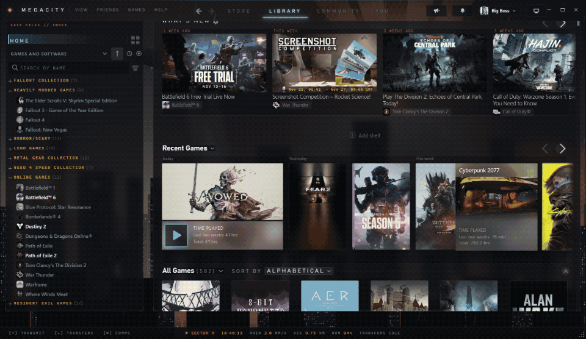
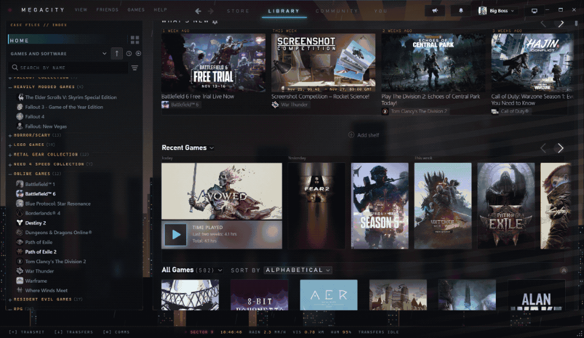

# Megacity

**Future noir.** A rain-soaked megacity at night, seen from an analyst's desk. A [Millennium](https://steambrew.app) theme for the Steam client.

- **A living city** behind smoked glass, drawn live: a stepped megastructure glowing in the haze, towers of lit windows and vertical neon, flare stacks that burst into fireballs and light the smog orange, an ad blimp drifting overhead sweeping searchlights through the rain, flying cars with blinking light bars, windows flickering on and off, and rain over all of it.
- **Light through the blinds:** every so often slatted beams slide across the whole desk.
- **Neon tube navigation:** Store · Library · Community · You in thin, wide-tracked capitals; the current one is lit cyan, stutters on like a real tube and buzzes now and then.
- **Case files and the analysis machine:** the game list is an index of case files; on a game page the artwork gets a measurement grid and corner marks, and a tracking crosshair with live coordinates follows your cursor.
- **A console strip** along the bottom: transmit, transfers and comms, and a live readout of the sector, time, rainfall, visibility, humidity and download progress.
- **Graded stills:** cover art sits washed out under the rain light and regains its colour under the cursor. The Play button is a lit neon tube.
- **The opening:** an eye under examination, its pupil contracting, before the name flickers on.

## Install

1. Install [Millennium](https://steambrew.app).
2. Find **Megacity** in the Millennium theme browser, or download this repository into `Steam/millennium/themes/Megacity`.
3. Open **Steam → Millennium → Themes** and pick **Megacity**.

## Options

Open **Millennium → Themes → Megacity** to change:

Mood (Night, Dust, Ice) · Weather (Rain, Downpour, Snow, Dry) · City (Live, Still, Off) · Light through blinds · Analysis overlay · Covers · Film grain · Panel transparency · Density · What's New · Readout · Startup screen · Motion · Cursor light · Privacy · Contrast · Focus rings · Text size

Everything here is original: no other game's names, logos, art or fonts. Fonts are ones that ship with Windows.

## License

MIT, see [LICENSE](LICENSE).
